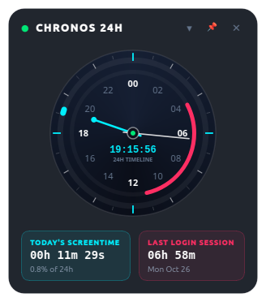
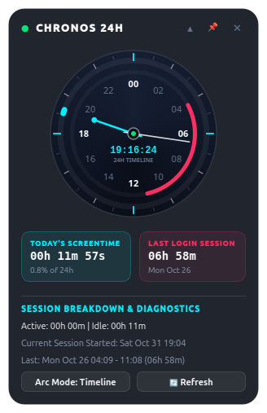

# ⏱️ 24-Hour Screentime & Login Session Clock

A glassmorphic desktop widget that displays **Today's Screentime** and your **Last Login Session Screentime** in a 24-hour analog clock face.

---

## 🖼️ Previews

| Compact 24H Clock Dial | Expanded Session Diagnostics |
| :---: | :---: |
|  |  |

---

## ✨ Features

- **24-Hour Analog Clock Dial**:
  - Full 24-hour circular polar dial with 15° per hour spacing (00:00 midnight at top, 06:00 dawn at right, 12:00 noon at bottom, 18:00 dusk at left).
  - Day/Night atmospheric gradient plate distinguishing day vs night hours.
  - Precision 24-hour hour hand and 60-minute hand.
  - Antialiased vector graphics rendered via PyQt6 QPainter.

- **Dual Screentime Arcs**:
  - **Today's Screentime Arc (Vivid Neon Cyan)**:
    - **Timeline Mode**: Highlights the active hours and intervals worked on the screen today.
    - **Gauge Mode**: A sweeping proportional progress ring showing percentage of the 24-hour day spent on screen.
  - **Last Login Session Arc (Vibrant Neon Rose)**:
    - Concentric inner track depicting the exact time window and duration of your previous session (e.g., `06h 58m` from Monday).

- **Hardware-Level Idle Detection**:
  - Direct native integration with X11 XScreenSaver extensions (`libXss.so.1`) to monitor keyboard and mouse idle times without heavy polling.
  - Visual activity status indicator: Emerald dot (`● Active`) vs Amber dot (`○ Idle`).

- **Draggable & Screen Persistent**:
  - Click and drag anywhere on the glass body to place it on any monitor.
  - Saves and restores desktop screen coordinates automatically across reboots in `data/widget_config.json`.
  - Right-click context menu: Always on Top, Toggle Arc Mode, Refresh, Expand/Collapse.

- **Systemd Autostart**:
  - Runs in the background as a managed `systemd --user` service (`screentime-clock.service`).
  - Automatically initializes when Linux boots into the desktop session.

---

## 🚀 Quick Commands

```bash
# Check service status
systemctl --user status screentime-clock.service

# Restart widget
systemctl --user restart screentime-clock.service

# Stop widget
systemctl --user stop screentime-clock.service

# Run directly from terminal
/home/ameya/screentime-clock/run.sh
```

---

## 📂 Project Structure

```
/home/ameya/screentime-clock/
├── run.sh                  # Launcher shell script with X11 readiness wait
├── main.py                 # Application lifecycle coordinator
├── config.py               # Settings and configuration
├── tracker.py              # Screentime accumulator, idle detector & wtmp parser
├── gui/
│   ├── styles.py           # Design tokens and obsidian glass stylesheet
│   ├── clock_dial.py       # Vector-rendered 24-hour analog dial
│   └── desktop_widget.py   # Draggable desktop HUD widget
├── data/
│   ├── screentime_widget_preview.png
│   └── screentime_widget_expanded_preview.png
└── lib/                    # Bundled X11 cursor libraries
```
